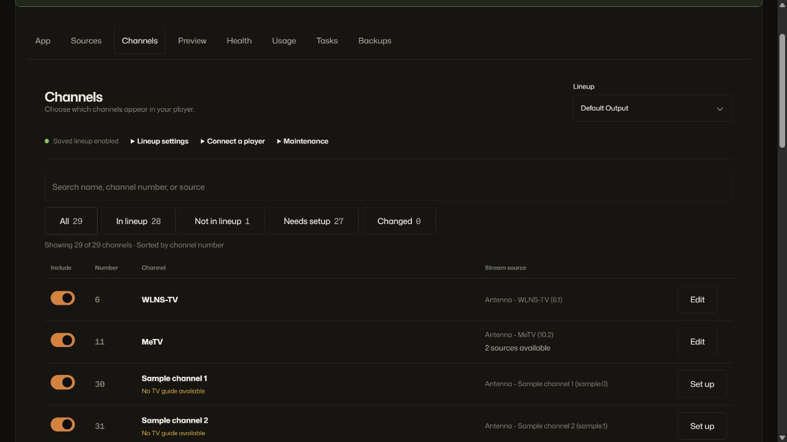
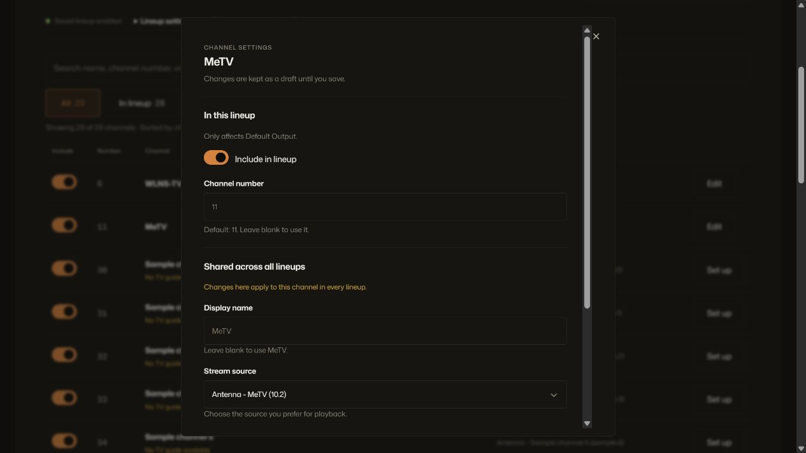
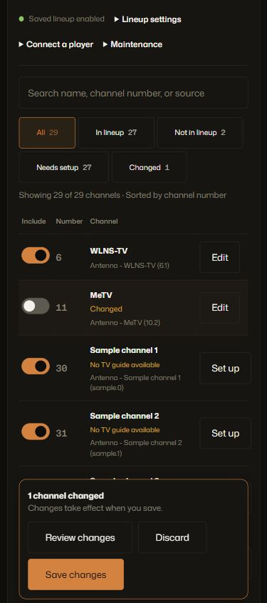

# Channels UX implementation validation

Date: 2026-10-25. Initial local validation after explicit design approval. Subsequently committed, pushed, and deployed with the latest changes; see `channels-release.md` for release evidence.

## Delivered

- Compact channel list with name/number/source search, inclusion controls, setup reasons, and counted filters.
- Per-channel editor that separates lineup settings from shared channel settings. Technical details stay available in a disclosure.
- Change review, complete discard, and a persistent Save/Discard bar. Closing the editor retains drafts.
- Guarded refresh, rescan, lineup switching/creation/duplication/deletion, and source saves. Failed writes retain drafts; failed reads after a successful write are reported separately.
- Saved publication state, player URL copy controls, collapsed maintenance controls, and mobile section navigation.
- Atomic lineup snapshot loading. After a lineup mutation, a failed read locks edits until a complete recovery read succeeds.

## Verification

The standalone fixture at `test/fixtures/admin-channels-preview.mjs` serves the real Vue application with in-memory data. It binds only to 127.0.0.1:5178. No production settings, real providers, or database were used for editing tests. Query flags on `/__fixture` allow `failSave`, `failRead`, `failReadAfterSave`, and `empty`; restarting resets the fixture.

Browser checks passed in Chromium at desktop and 390 × 844:

- Searching effective number 11 finds MeTV; name and source search remain supported.
- Renaming, number changes, source choice, inclusion, and scoped before/after review work. Number changes do not change the active editor identity.
- Setting GREAT's missing number enables its inclusion control without including it automatically. Unselected and unavailable sources have different guidance.
- Cancel preserves drafts and the selected lineup. Explicit discard restores number text, names, source/guide choices, inclusion, and lineup metadata.
- A failed save prevents a pending lineup switch and retains edits with an error. A successful write followed by a failed read clears committed drafts and shows Retry refresh.
- Source save prompts before writing when channel drafts exist. Normal channel save updates inclusion and clears Changed.
- Draft lineup availability does not change saved publication status or URLs.
- Escape closes the editor and restores row focus. When Changed filtering removes the row, closing restores search focus. No-results and empty states provide clear next actions; initial read failure shows Retry instead of the first-channel prompt.
- The mobile section selector reflects the active pane, the editor scrolls without horizontal overflow, and Save/Discard stays inside the viewport (bar bottom 838px in an 844px viewport).
- Independent review found a stale-snapshot risk after lineup deletion plus a failed read. Reproduced before the fix: Default selected while Family rows remained editable. Verified after the fix: selection/rows stay together, edit controls are disabled, Retry remains enabled, and recovery atomically loads Default before editing resumes.

Pure helper tests were observed failing before implementation and then passing. Final checks:

| Check | Result |
| --- | --- |
| Workflow and existing draft-state tests | 13 passed |
| Full non-integration suite | 214 passed |
| Full integration suite | 218 passed, 3 failed in untouched canonical/OAuth tests |
| Targeted ESLint | Passed |
| Vue script and template compilation | Passed |
| `git diff --check` | Passed |

The three integration failures also reproduced in a focused run of those two test files. They do not import the changed UI:

1. `test/integration/canonical-routes.test.js:169`: discovered channel publication expectation (`false` versus `true`).
2. `test/integration/canonical-routes.test.js:480`: renamed/renumbered canonical mapping deep-inclusion expectation.
3. `test/integration/oauth.test.js:171`: OAuth metadata expects `127.0.0.1` but receives `localhost`.

No admin build was run. Generated public/admin files and API/MCP interfaces were not changed. Existing unrelated `server/epg.js` and `test/integration/guide.test.js` changes were preserved. No physical-device, Safari, Firefox, production playback, or live deployment verification was performed.

## Screenshots

The screenshots use disposable fixture channels, not production data.

